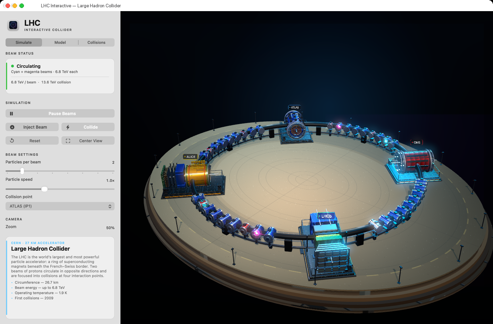

# LHC Interactive

A native macOS application that turns the Large Hadron Collider into an explorable SceneKit model. Built with Objective-C, AppKit and SceneKit, it combines an interactive 27 km accelerator ring with a configurable particle-collision simulator and an educational component inspector.



## Highlights

- **Procedural 3D model** — the entire accelerator, terrain, tunnel, magnet lattice and all four experiments are generated in code with layered subdetectors, structural supports and physically based surface detail. No external 3D assets or runtime dependencies.
- **Four detailed detectors** — ATLAS with its blue toroids, segmented end-cap calorimeter and muon chambers, CMS with its red barrel and silver yoke, ALICE with its heavy yellow/green central detector, and LHCb with a layered forward spectrometer and open muon-station grids.
- **Twin proton beams** — counter-rotating cyan and magenta beams, each carrying one or more bright tracer particles with comet tails, orbit the ring at beam height inside the magnet lattice with adjustable particle count and speed.
- **Configurable collision events** — choose an interaction point, an event preset, particle count, emission spread, lifetime, velocity and particle size. Collisions combine a multi-stage event display with a core flash, curved particle tracks, shockwave rings, plasma, sparks, embers and a screen flash.
- **Live inspection and focus** — click a detector, a magnet or a floating label to update the inspector with a concise explanation of the hardware and smoothly centre the camera on it.
- **Model controls** — toggle terrain, tunnel, magnets, detectors and labels; adjust tunnel opacity, detector footprint scale and a cutaway view.
- **Persistent configuration** — simulation and appearance settings are stored in `NSUserDefaults` under `org.cern.lhc.interactive.configuration.v1`.

## Requirements

- macOS 13 Ventura or later
- Xcode 15 or later (the project is generated for modern Xcode and built with ARC)
- No third-party frameworks are required at runtime

XcodeGen and Pillow are only needed if you want to regenerate the Xcode project or the application icon.

## Build and run

### Xcode

1. Open `LHC.xcodeproj`.
2. Select the `LHC` scheme and the `My Mac` destination.
3. Press **Run** (⌘R).

The project is already generated and checked in. If you change `project.yml`, regenerate it with:

```sh
xcodegen generate
```

### Command line

```sh
xcodebuild \
  -project LHC.xcodeproj \
  -scheme LHC \
  -configuration Release \
  -derivedDataPath build \
  CODE_SIGNING_ALLOWED=NO \
  build

open build/Build/Products/Release/LHC.app
```

For an unsigned local Debug build, change `Release` to `Debug`.

> **Xcode note:** The shared scheme disables Metal API Validation for Run. SceneKit's HDR post-processing currently creates an invalid texture view in the validation layer, which Xcode otherwise reports as a debugger stop. If validation is enabled manually, the app automatically falls back to its LDR render path.

## Using the app

### 3D view

| Gesture | Action |
| --- | --- |
| Drag | Orbit the camera |
| Scroll / pinch | Zoom |
| Click a detector, magnet, RF cavity, beam or floating label | Inspect that component and focus the camera on it |
| **Center View** in the 3D view, **Center View** in the Simulate tab or ⌘0 | Return to the overview camera |

Use the **Zoom** slider for a stable, inspector-friendly framing. It changes the camera distance directly and stays in sync with scroll, pinch and click-to-focus movements.

### Help

Open **Help → LHC Interactive Help** or press ⌘? for a concise overview of the 3D navigation, inspector tabs, simulation controls, collision lab, model options and keyboard shortcuts. The same window includes the Xcode Metal-validation workaround and troubleshooting notes.

### Simulation

- **Pause Beams / Start Beams** freezes or resumes the orbiting bunches and tracers.
- **Inject Beam** replays the injection ramp before settling back into circulation.
- **Collide** fades the circulating bunches, sends two incoming clusters into the selected interaction point and runs the configured collision effect.
- **Particles per beam** (1–8) sets how many bright tracer particles circulate in each direction.
- **Particle speed** (0.2–2.5×) controls the orbital speed of the beams.
- The **Beam status** card reports the current state, beam energy and active event.
- Menu equivalents live in **Simulation**: Space for play/pause, ⌘I to inject, ⇧⌘C to collide, ⌘R to reset the simulation.

### Model tab

Control which layers are visible and how the model is presented:

- Terrain, tunnel, magnets, detectors and labels
- Tunnel opacity
- Horizontal detector scale (kept horizontal so the beamline stays aligned)
- Cutaway view
- A colour key for the magnet lattice and the two beams
- Reset all model options

### Collisions tab

Choose the target experiment and tune the collision effect:

- **Event presets**: proton–proton at 13.6 TeV, Higgs → γγ at 125 GeV, lead–lead at 5.02 TeV, and a beauty-physics event for LHCb
- **Particles per event** (120–3000)
- **Emission spread** (20–180°)
- **Particle lifetime** (0.5–4.0 s)
- **Particle velocity** (1–20 units/s)
- **Particle size** (0.02–0.35)
- **Test burst** runs the current settings at the selected interaction point
- **Reset particle settings** restores the collision defaults

Configuration changes are saved automatically. Use the **Reset** button in the Simulate tab to restore the full simulation state.

## Architecture

The app follows a small, explicit MVC split:

| File | Responsibility |
| --- | --- |
| `LHC/AppDelegate.h/.m` | Programmatic application lifecycle, main window, menus, About panel and Help window |
| `LHC/LHCViewController.h/.m` | AppKit inspector, simulation state machine, SceneKit host, hit testing and animation orchestration |
| `LHC/LHCHadronModel.h/.m` | Procedural scene construction: terrain, ring, magnets, detectors, beams, labels, selection highlight and camera/lighting |
| `LHC/LHCSimulationConfig.h/.m` | Validated simulation/appearance configuration, event presets and `NSUserDefaults` persistence |
| `LHC/LHCParticleSystemFactory.h/.m` | Reusable `SCNParticleSystem` event burst, particle tracks, shockwave and incoming-bunch visuals |
| `LHC/LHCSceneView.h/.m` | `SCNView` subclass that distinguishes a click from an orbit drag and forwards orbit, scroll and pinch gestures |
| `LHC/LHCPartInfo.h/.m` | Immutable educational metadata for every inspectable component |
| `LHC/main.m` | Programmatic application entry point |

The UI is entirely programmatic — there is no storyboard or nib. `LHCHadronModel` owns the 3D scene and is deliberately independent of AppKit controls: the controller changes configuration and calls model update methods, while the model exposes named parts, nodes and metadata for selection.

## Educational content

The inspector describes the accelerator and experiments with short, physics-focused notes:

- The LHC circulates two proton beams in opposite directions through a 26.7 km ring of superconducting magnets.
- Protons reach 6.8 TeV per beam, producing 13.6 TeV collisions at the interaction points.
- The magnets operate at 1.9 K (−271.3 °C), colder than outer space.
- ATLAS and CMS are general-purpose detectors; ALICE studies quark–gluon plasma in heavy-ion collisions; LHCb investigates matter–antimatter differences through beauty-hadron decays.
- The first LHC collisions took place in 2009.

The magnet colour code is visible in the model: blue dipole sections bend the beams, while red quadrupole sections focus them.

## Regenerating the icon

The application icon is generated procedurally with Pillow and assembled into `LHC/Resources/AppIcon.icns`:

```sh
python3 -m pip install pillow
python3 tools/generate_app_icon.py
```

The script writes the complete macOS iconset (16–1024 px) and the final `.icns` file. `AppIcon.icns` is bundled as a resource and referenced by `CFBundleIconFile` in `LHC/Resources/Info.plist`.

## References and credits

- [CERN — The Large Hadron Collider](https://home.cern/science/accelerators/large-hadron-collider)
- [Build Your Own Particle Detector — LHC micro models](https://build-your-own-particle-detector.org/models/lhc-micro-models/) by Nathan Readioff, University of Liverpool.
  The papercraft detector references in `images/` were used only as visual and educational references for the procedural SceneKit interpretation. They are not redistributed as part of the application.
- LHC and detector names are used for educational identification. This project is an independent educational visualization and is not an official CERN product.

All 3D geometry, animation, UI and icon artwork in this repository are generated by the project code.
